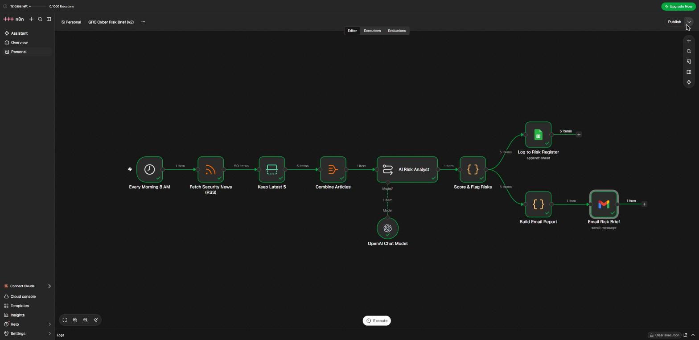
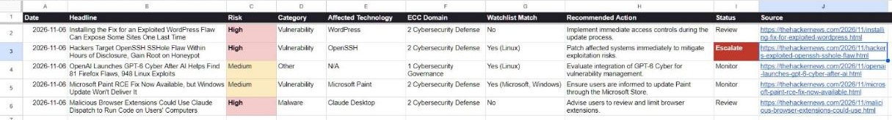
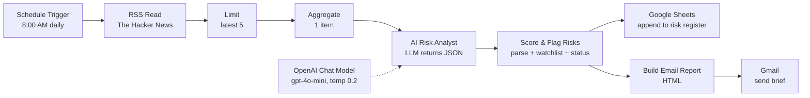

# Cyber Threat to Risk Register (n8n + LLM)

An n8n workflow that turns daily cybersecurity news into **risk register entries**. Every morning it reads the latest stories, uses an LLM to classify each one (risk level, category, affected technology, related **NCA ECC** domain, recommended action), flags anything that hits a technology watchlist, logs every record to Google Sheets, and emails a formatted risk brief.

It started as a simple AI news summarizer (v1, still included) and grew into a small GRC tool (v2).

## What it produces

**Risk register (Google Sheets).** One row per story, appended on every run:

| Column | Meaning |
|---|---|
| Risk | High / Medium / Low, set by the LLM from the article text |
| Category | Vulnerability, Threat Actor, Data Breach, Malware, Policy/Regulation, Other |
| Affected Technology | Product or vendor named in the story |
| ECC Domain | The NCA Essential Cybersecurity Controls main domain the story relates to most |
| Watchlist Match | Whether the story mentions a technology on the watchlist (rule-based, not AI) |
| Recommended Action | One short action for the security team |
| Status | **Escalate** = High risk + watchlist match, **Review** = High risk, **Monitor** = everything else |
| Source | Original article link, for verification |

**Email brief.** An HTML email sorted by risk, with a summary line such as `5 items · High: 3 · Medium: 2 · Escalate: 1`.

## How it works

| # | Node | Type | Job |
|---|------|------|-----|
| 1 | Every Morning 8 AM | Schedule Trigger | Starts the run daily |
| 2 | Fetch Security News (RSS) | RSS Read | Pulls the latest stories |
| 3 | Keep Latest 5 | Limit | Keeps the 5 newest |
| 4 | Combine Articles | Aggregate | Merges them so the LLM sees all 5 at once |
| 5 | AI Risk Analyst | Basic LLM Chain | Returns a JSON array, one record per story |
| 6 | OpenAI Chat Model | gpt-4o-mini | Model behind the analyst, low temperature |
| 7 | Score & Flag Risks | Code (JS) | Parses the JSON, checks the watchlist, sets Status |
| 8 | Log to Risk Register | Google Sheets | Appends one row per record |
| 9 | Build Email Report | Code (JS) | Builds the HTML brief, sorted by risk |
| 10 | Email Risk Brief | Gmail | Sends the brief |

## Design choices

- **AI classifies, rules decide.** The LLM does the reading and tagging. The escalation decision (High + watchlist match) is plain code, so it is predictable and auditable.
- **Structured output.** The prompt asks for a strict JSON array with fixed keys and allowed values, so every row in the register has the same shape.
- **Framework mapping.** Each item is tagged with one of the five NCA ECC main domains (Governance, Defense, Resilience, Third-Party and Cloud, ICS), which ties the news to a control framework used in Saudi Arabia.
- **Traceability.** Every record keeps its source link and the run date, and the email reminds the reader to verify AI output before acting.
- **No secrets in the repo.** Credentials live in n8n's encrypted credential store. The exported JSON has placeholders only.

## Run it yourself

1. Make a Google Sheet with this header row (or import `risk-register-template.csv`):
   `Date, Headline, Risk, Category, Affected Technology, ECC Domain, Watchlist Match, Recommended Action, Status, Source`
2. In n8n: **... > Import from File** and pick `workflow/grc-cyber-risk-brief-v2.json`.
3. **OpenAI Chat Model:** choose a credential (OpenAI API key, or n8n Cloud AI credits).
4. **Log to Risk Register:** sign in with Google, then pick your sheet and tab.
5. **Email Risk Brief:** connect Gmail and replace `YOUR_EMAIL@example.com`.
6. Edit the `WATCHLIST` array in **Score & Flag Risks** to match the technologies you care about.
7. Click **Execute** to test, then **Publish** to run it on schedule.

## v1: simple AI digest

`workflow/daily-security-news-ai-digest.json` is the first version: RSS, LLM summary with a risk level, plain-text email. A run from 4 Nov 2026:

## Limitations

- Risk levels come from an LLM reading short RSS snippets, not from CVSS scores or asset inventory, so treat them as triage, not a final assessment.
- The watchlist is keyword matching and can miss or over-match.
- One news source only. More feeds (vendor advisories, CISA KEV, NCA alerts) would improve coverage.

## Next steps

- Add CISA KEV and vendor advisory feeds
- Deduplicate stories already in the register
- Weekly summary of open Escalate items

## Tools

n8n Cloud 2.46 · OpenAI gpt-4o-mini · Google Sheets · Gmail · JavaScript
