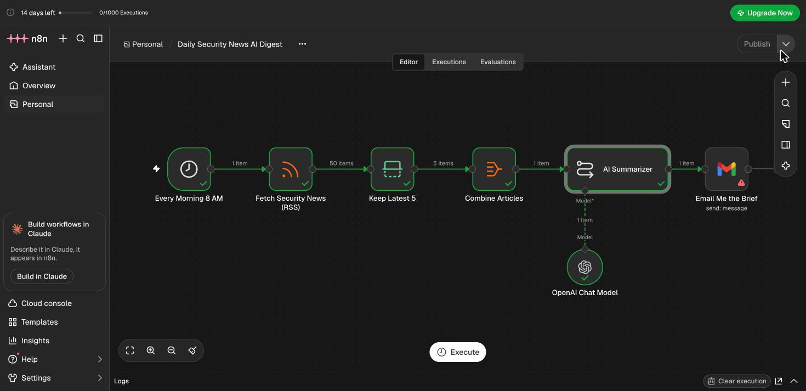
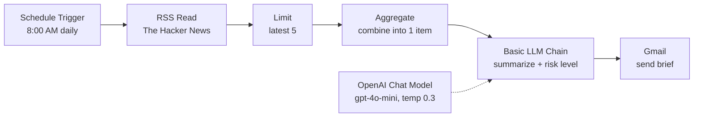
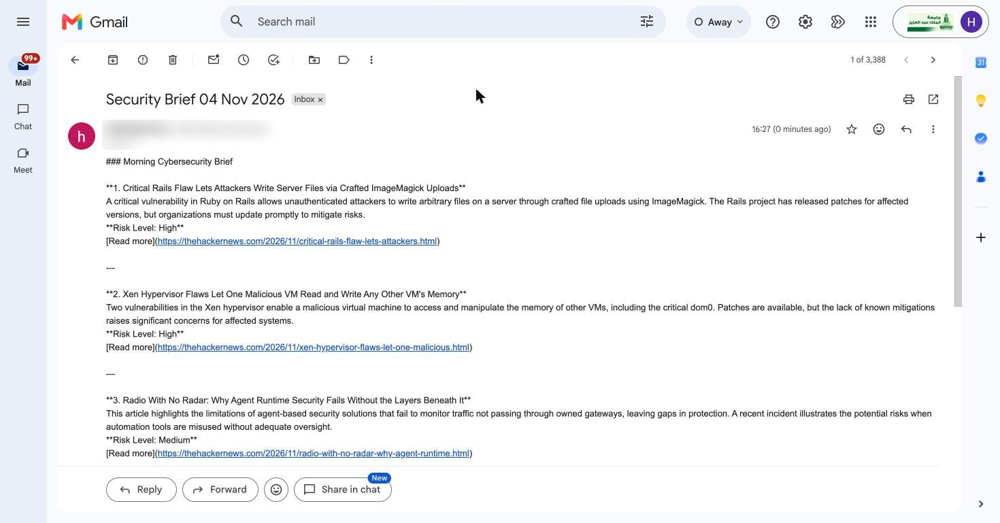

# Daily Security News AI Digest (n8n)

An n8n workflow that reads the latest cybersecurity news every morning, uses an LLM to summarize each story and give it a risk level (Low / Medium / High), and emails me a short brief.

I built it to replace a manual routine: opening news sites, skimming articles, deciding what matters, and writing notes.



## How it works



| # | Node | Type | What it does |
|---|------|------|--------------|
| 1 | Every Morning 8 AM | Schedule Trigger | Starts the workflow daily at 8:00 |
| 2 | Fetch Security News (RSS) | RSS Read | Pulls the latest articles from The Hacker News feed |
| 3 | Keep Latest 5 | Limit | Keeps the 5 newest items |
| 4 | Combine Articles | Aggregate | Merges the 5 items into one list so the AI sees them together |
| 5 | AI Summarizer | Basic LLM Chain | Writes the brief: headline, 2-sentence summary and risk level per story |
| 6 | OpenAI Chat Model | gpt-4o-mini | The model behind the summarizer (temperature 0.3) |
| 7 | Email Me the Brief | Gmail | Sends the brief with the date in the subject |

## The prompt

```
You are a security analyst. Summarize these {{ $json.title.length }} cybersecurity news articles into a short morning brief.
For each article give: a one-line headline, a 2-sentence summary, and a risk level (Low / Medium / High).
End with one line: "Top action for today".
```

The titles, snippets and links from the Aggregate node are passed in with n8n expressions, so every item keeps its source link for checking.

## Result

A real run on 4 Nov 2026: 50 articles fetched, 5 kept, 1 brief sent.



## Run it yourself

1. In n8n, create a new workflow and choose **... > Import from File**.
2. Select `workflow/daily-security-news-ai-digest.json`.
3. Open **OpenAI Chat Model** and pick a credential (an OpenAI API key, or n8n Cloud's built-in AI credits).
4. Open **Email Me the Brief**, connect your Gmail account and replace `YOUR_EMAIL@example.com` with your address.
5. Click **Execute** to test, then **Publish** so it runs on schedule.

No credentials are stored in the workflow file. n8n keeps them in its own encrypted credential store.

## Design choices

- **Aggregate before the AI step.** Without it the LLM would run once per article and send five separate emails.
- **Fixed output format in the prompt.** Every brief has the same structure, which makes it easy to scan.
- **Low temperature and source links.** Reduces made-up details and lets the reader verify each claim.

## Next steps

- Add a Markdown node so the email renders as formatted HTML instead of plain text
- Log High-risk items to Google Sheets as a simple risk register
- Filter stories by keywords for software in use, to track relevant CVEs
- Send to Telegram or Slack as well as email

## Tools

n8n Cloud 2.46 · OpenAI gpt-4o-mini · Gmail · RSS
